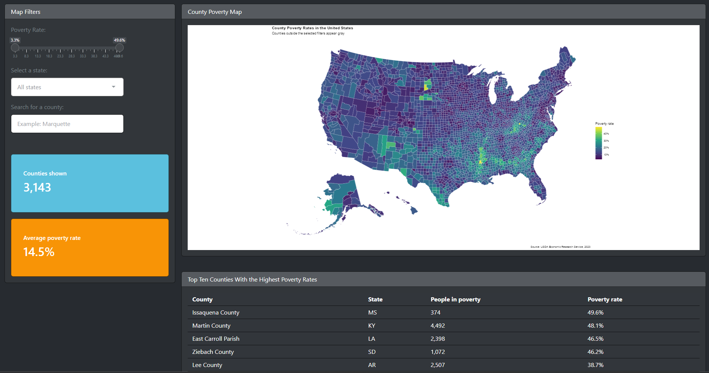

# United States County Poverty Explorer

**Author:** Diego Carrillo

## The question
How do poverty rates vary among counties across the United States? This app allows users to explore county poverty patterns by filtering the data by poverty rate, state, and county name.

## The data
- **Source:** [USDA Economic Research Service County-Level Data Sets](https://ers.usda.gov/data-products/county-level-data-sets/county-level-data-sets-download-data)
- **One row is:** One United States county in 2023
- **Variables I use:** County FIPS code, state abbreviation, county name, number of people in poverty, and poverty rate
- **Cleaning:** I cleaned the variable names, pivoted the original long data so each county has one row, formatted FIPS codes as five-character values, removed national and state summary rows, converted the poverty measurements to numeric variables, and removed counties missing the values used by the app.

## How to run it
1. Install the packages: `install.packages(c("shiny", "bslib", "tidyverse", "janitor", "usmap", "scales"))`
2. Open `usmap_app.R` in Positron and click **Run App**.

## What the app does
- **Inputs:** A poverty-rate slider filters counties by a numerical range, a state menu focuses the map on counties from one state, and a county search allows users to find a specific county by name.
- **Outputs:** A county map displays poverty rates geographically, a table lists the ten highest-poverty counties among the filtered results, and two value boxes report the number of counties shown and their average poverty rate.

## One thing I learned
I learned how to use str_trim(), and str_detect() to prevent the county search bar from thowing errors if a typo or extra space is present. I also learned how to use validate() and need() together to give clean error messeage when an input is invaild instead of creashing the app. 

## Limitations
The data describe counties during 2023 and do not show how poverty rates have changed over time. County-level values are aggregated estimates, so they do not describe every person within a county. The app also shows geographic patterns and descriptive comparisons but cannot explain what caused the differences in poverty rates.

