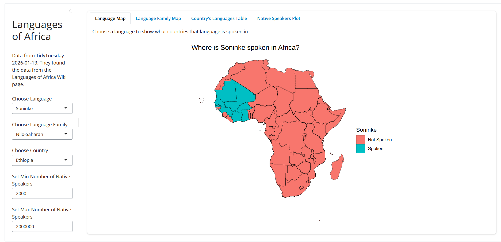
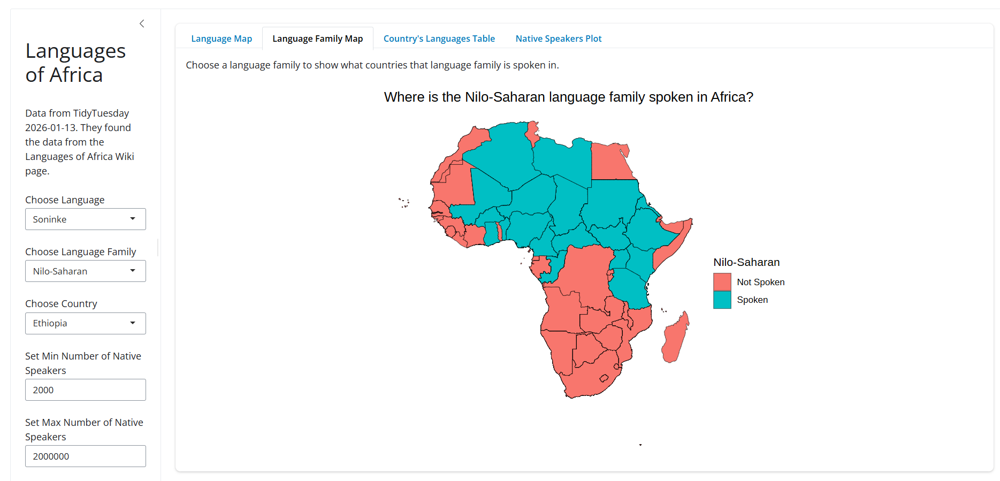
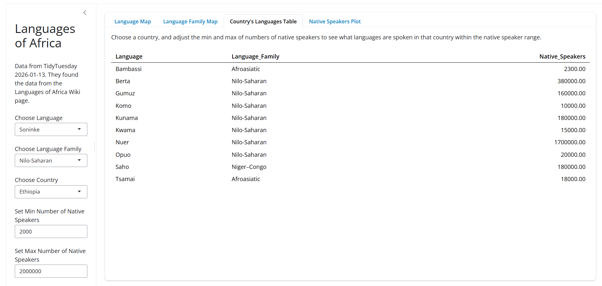
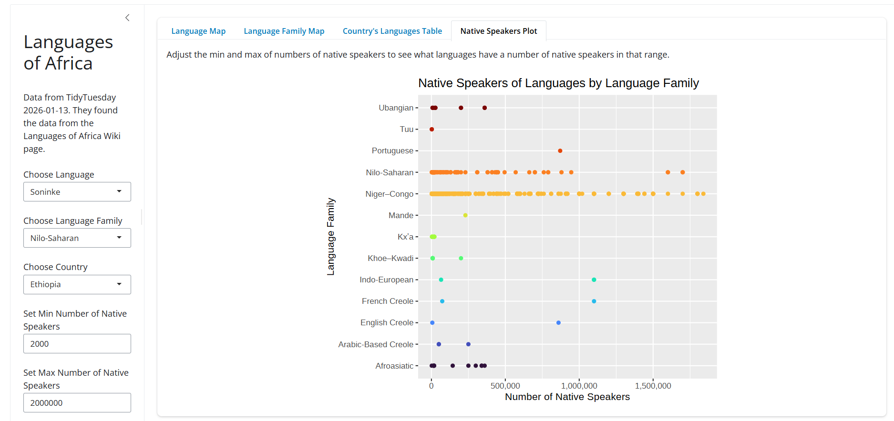

# Languages of Africa

**Author:** Janson Duerst

## The question
What languages are spoken in Africa, how many native speakers are there, and where are they spoken?

## The data
- **Source:** [The Languages of Africa](https://github.com/rfordatascience/tidytuesday/blob/main/data/2026/2026-01-13/readme.md)
- **One row is:** A language of Africa
- **Variables I use:** language, country, family, native_speakers
- **Cleaning:** Changed some of the family names because the dataset cut them short (ie French instead of French-Creole), changed some of the names of the countries in the geometry data because they did not match the ones in the language data (ie Cabo Verde vs Cape Verde), made sure any missing values in the language or family variables were set to "No Language Data"

## How to run it
1. Install the packages: `install.packages(c("shiny", "bslib", "tidyverse", "rnaturalearth", "rnaturalearthdata", "sf", "scales", "ggiraph"))`
2. Open `app.R` in Positron and click **Run App**. Make sure to run the app within `shiny-project`.

## What the app does
- **Inputs:** Language Selection: To look at a specific language

Language Family Selection: To look at a specific language family

Country Selection: To look at a specific country

Min Number of Native Speakers Numeric: To look at languages with a specific minimum of native speakers

Max Number of Native Speakers Numeric: To look at languages with a specific maximum of native speakers

- **Outputs:** Language Map: to see what countries a specific language is spoken in

Language Family Map: To see what countries a specific language family is spoken in

Languages in the Country Table: To see what languages are spoken in a specific country that are within a specific range of number of native speakers

Number of Native Speakers Plot: To see what languages spoken are within a specific range of number of native speakers, and what language families they come from

## One thing I learned
The first thing I learned is the sheer number of languages spoken in Africa. I was very surprised to hear that there are thousands. The dataset just contains about 500 of the most prominent. I also learned that languages from the Niger-Congo language family are spoken almost across the entire contitent.

## Limitations
The dataset treated Somalia and Somaliland as one country, so there is no data for Somaliland.
There is not language data for DRC, Western Sahara, and Guinea-Bissau
The geometry for African countries did not include Mauritius and Seychelles, two countries off the coast of Africa, so the maps do not show them.
The Wikipedia article has some native speaker populations from the 2010s, 2000s, 1990s (and one all the way back from the 1960s), so these populations may not be the most accurate.

## Screenshots

