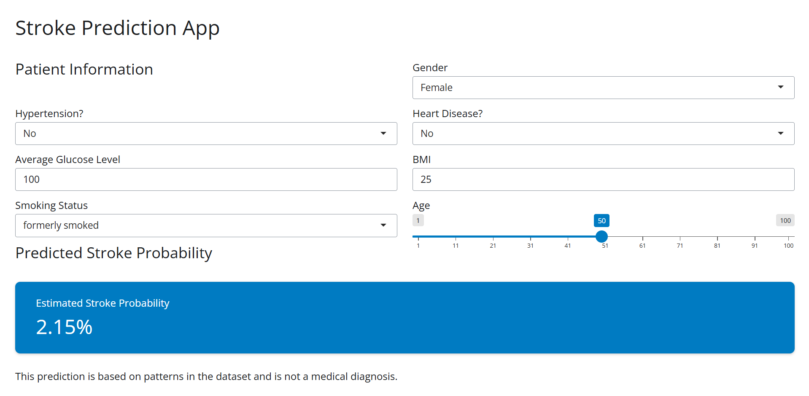

# Stroke Prediction App

**Author:** Jett Morton

## The question
How do patient characteristics, such as gender, age, hypertension, heart disease, glucose level, body mass index (BMI), and smoking status, relate to the likelihood of stroke?

## The data
- **Source:** [Stroke Prediction Dataset - Kaggle](https://www.kaggle.com/datasets/fedesoriano/stroke-prediction-dataset)
- **One row is:** One individual patient and their health information.
- **Variables I use:** Gender, age, hypertension, heart disease, average glucose level, body mass index (BMI), smoking status, and stroke.
- **Cleaning:** - janitor clean_names
                - Checked variable types and converted categorical variables into factors because R likes factors.
                - Removed missing values (N/A) from data

## How to run it
1. Install the packages: `install.packages(c("shiny", "bslib", "tidyverse", "janitor"))`
2. Open `app.R` in Positron and click **Run App**.

## What the app does
- **Inputs:** 
- Gender: select a for gender.
- Age: slider to select for age.
- Hypertension: select for hypertension.
- Heart Disease: select heart disease.
- Average Glucose Level: enter a glucose level.
- BMI: enter a body mass index.
- Smoking Status: select a smoking category.

- **Outputs:** 
- Predicted Stroke Probability: Shows the estimated probability based on the patients information.

## One thing I learned
<Something you discovered by using your own app.>

## Limitations
- In the dataset there are more patients without strokes than patients with strokes.
- The predictions are not clinically validated and should not be used to make medical decisions.
- Missing information may affect stroke outcomes.

