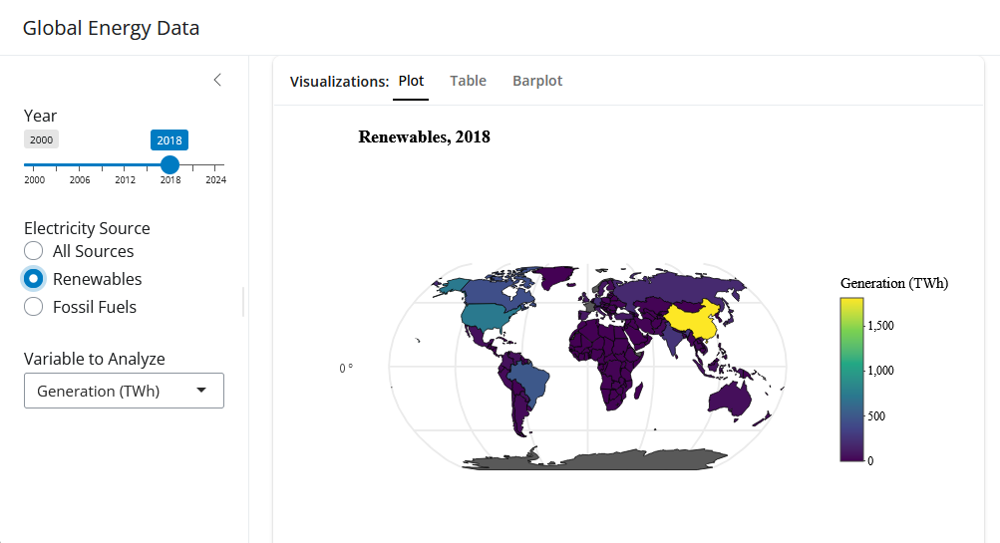

# Energy Viewer

**Author:** Joshua Lehto

## Questions

- What countries produce the most energy, and who uses fossil fuels/renewables the most?

- How do fossil fuels and renewables compare in energy-producation and emissions?

## The Data

- **Source:**

[Ember - Yearly Electricity Data](https://ember-energy.org/data/yearly-electricity-data/)

- **Info:**

Ember is an independent non-profit clean-energy think tank. From the link above, they explain that "This dataset contains yearly electricity generation, capacity, emissions, import and demand data for over 200 geographies. Data is collected from multi-country datasets (EIA, Eurostat, BP, UN) as well as national sources (e.g China data from the National Bureau of Statistics)."

- **Variables I use:**

(From my final cleaned dataset)

1.  `area`
2.  `iso_a3`
3.  `year`
4.  `electricity_source`
5.  `generation_twh`
6.  `share_of_generation`
7.  `emissions_mt_co2e`
8.  `geometry`

- **Cleaning:**

Below describes columns I remove from the inital dataset.

1.  Columns that describe region like `Continent` and `Ember region` as I instead rely on `Area` and `ISO 3 Code`.
2.  `Is aggregated source` and `Capacity (GW)` are removed as they aren't being analyzed.
3.  `Share of emissions (%)` and `Emissions intensity (gCO2e/kWh)` are removed as I instead rely on `Emissions (MtCO2e)` for this analysis.
4.  All variables describing year-over-year change are removed.
5.  Columns describing membership in global organizations like the EU, ASEAN, and G20 are removed.

## How to Run the App

1.  Open `app.R` in Positron and click **Run App**. All necessary packages should install and load accordingly.

## What the App Does

- **Inputs:**

`Year`: Changes the year being observed for the map plot and table, and determines up to what year information is displayed on the barplot.

`Electricity Source`: Choose between All Sources, Renewables, and Fossil Fuels.

`Variable to Analyze`: Select one of three categories to compare the variables above.

- **Outputs:**

`Map Plot`: Interactive map to compare country behaviors.

`Table`: Interactive table to compare country behaviors.

`Barplot`: Examine global trends given the variable above over time (Includes all countries).

## One thing I learned

More countries relied heavily, if not exclusively, on renewable energy than I had initially thought. Additionally, these countries have been doing so for a long while.

## Limitations

Data for some countries, like France and Norway, seems incomplete.

This app can't tell you about specific fossil fuels/renewables being used, but this could defintely be added as the data includes information about coal, gas, solar, wind, and other power sources.

