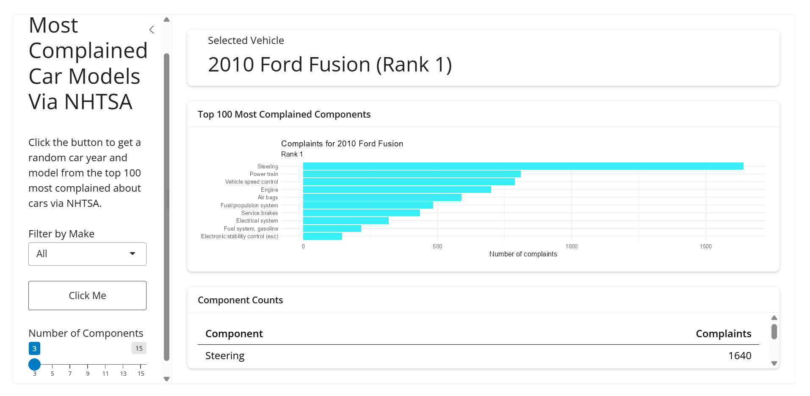

# **Top 100 Most Complained Cars' Components**

**Author:** `Olivia Browning`{=html}

## The question

Want to look at some of the worst cars from the past decade that have the most complaints for certain aspects of it? This app uses a dataset based on NSTHA complaints to rank vehicles based on most complaints.

## The data

- This dataset was sourced from [Kaggle](https://www.kaggle.com/datasets/iqbaltaherom/us-vehicle-owner-complaints-by-model-2010-2025/data). This dataset is based on two different files; a .json file and a .csv file. The csv file provides data about the numerical number of complaints about the vehicles and the json file provides a firm ranking. The data in these files are meant to be used together so not much cleaning is required. There is only some filtering such as only showing the components that had the most complaints. The variables used are; make, model, model_year, vehicle, rank, components, and complaints.

## How to run it

1.   install.packages(c("shiny", "bslib", "jsonlite", "tidyverse"))
2.  Run app.R

## What the app does

-  This app gives you a random car (year, model) among the top100 most complained about and gives you the data on the specific components that are the most complained. You can filter the top components of the specific vehicle that are most complained and/or you can filter by manufacturer to get a result from. These actions allow you to better understand what seem to be the most consistent problems with each vehicle.

## One thing I learned

One thing I learned is that my exact car, year and model, is ranked number 2 in this dataset. The most complained component for it though is something I have not had a problem with (yet, hopefully.)

## Limitations

This data is only in the top 100 of the most complained on NHTSA, so it is not reflective of every car ever and should not be used as complete data. This data does not include sales data, so more sold cars are more likely to make it on the list due to there being more owners.

