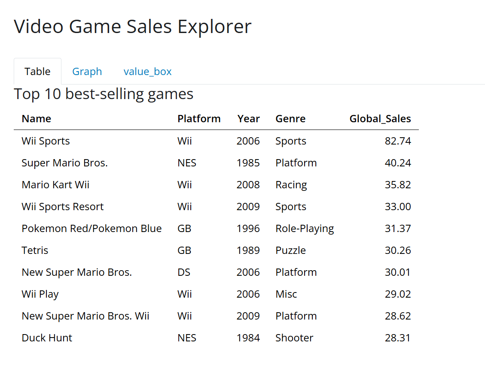

# Video Game Sales Explorer

**Author:** Rachel Brown

## The question
Which video games, platforms, and genres have sold the most, and how do Shooter, Puzzle, and Platform games compare across North America, Europe, Japan, and the rest of the world over time?

## The data
- **Source:** [Video Game Sales](https://www.kaggle.com/datasets/gregorut/videogamesales) (`vgsales.csv`, from Kaggle)
- **One row is:** one game on one platform (a game released on several platforms has several rows)
- **Variables I use:** `name`, `platform`, `year`, `genre`, `global_sales`, `na_sales`, `eu_sales`, `jp_sales`, `other_sales` (sales are in millions of copies)
- **Cleaning:**
  - Column names cleaned with `janitor::clean_names()` so they are consistent lowercase names.
  - `"N/A"` values in the file are read as missing, so `year` comes in as a number instead of text.
  - Rows with any missing value are dropped with `drop_na()`, so every row used has a year.
  - `year` converted to an integer so it sorts and filters correctly.
  - All cleaning runs once when the app starts, not on every click.

## How to run it
1. Install the packages: `install.packages(c("shiny", "bslib", "bsicons", "tidyverse", "janitor", "scales"))`
2. Put `vgsales.csv` in a `data/` folder next to `app.R`.
3. Open `app.R` in Positron and click **Run App**.

## What the app does
- **Inputs:**
  - **Slider:** removes low-selling games so you can see how platform totals change when you only count big hits. Sales is a continuous number, so a slider fits.
  - **Dropdown:** lets you look at one year or all years. Year is a set of distinct values, so a dropdown fits.
  - **Checkboxes:** lets you pick any combination of Shooter, Puzzle, and Platform. These are a few categories you may want to mix, so checkboxes fit.
- **Outputs:**
  - **Table of the top 10 best-selling games:** shows exact names and numbers, which a plot can't.
  - **Bar chart of global sales by platform:** bars compare totals across groups, and platforms are sorted so the biggest is easy to spot.
  - **Four value boxes:** give a quick total per region for each selected genre and year.
  - **Line plot, one panel per region:** lines show change over time, and separate panels with their own y-axes keep smaller regions like Japan readable next to larger ones.
- **Shared reactives:** `genre_data()` filters by genre and feeds the line plot and `year_data()`. `year_data()` adds the year filter and feeds all four value boxes.

## One thing I learned
 One thing I learned is how interactive I can make things in a shiny app. For example tab three where I can not only look at the three genres independently but also in different years. That could also affect the value boxes and graph.

## Limitations
- Sales figures are estimates collected from a website, not official publisher numbers.
- The data likely covers physical sales only, so it misses digital downloads and modern games.
- Each row is one game on one platform, so a game released on several platforms is counted once per platform in the totals.
- Rows with a missing value are removed, so the app is based on slightly fewer games than the raw file.
- Years near the end of the data have far fewer games, so the end of each line is not reliable.
- The regional tab only covers three genres, so it does not show the whole market.

